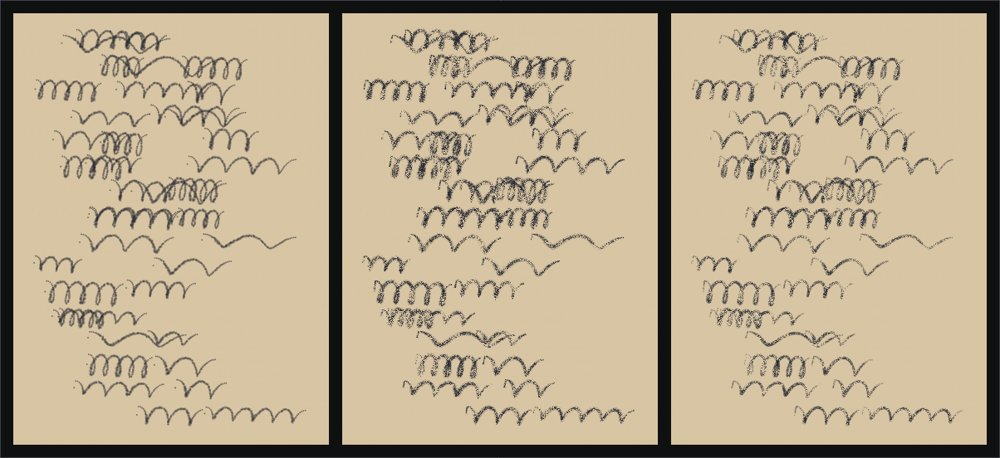
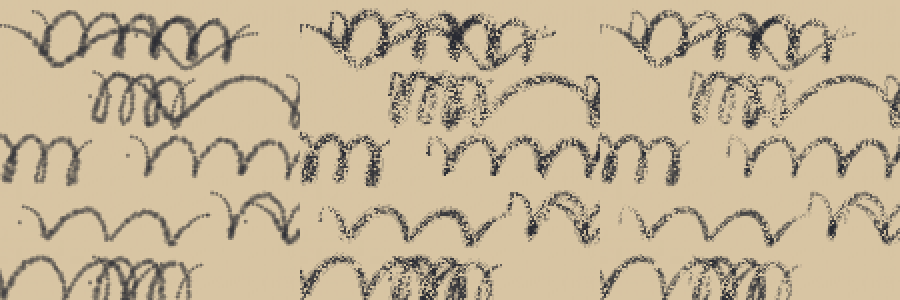

# Drawing on pages: brush spike

Phase 2's last task is drawing and writing on the passport's pages with a pencil-like brush whose grain lets the paper show through. Before building the tools, this spike compared three ways to draw such a brush in ImGui, on the same synthetic handwriting, in the headless checks (`tests/Wanderveil.UiChecks/BrushSpike.cs`, 20 October 2026). It is an experiment, not product code.

Left to right, zoomed:

## The approaches

- **A. Dabs.** Every sample of a stroke stamps three tiny, faint, jittered discs. Pure geometry, no texture.
- **B. Grain strip.** Each stroke is a band of quads as wide as the pressure, joined by averaged normals, with a second wider, fainter band to soften the edge. The quads sample a paper-tooth grain texture (a fine speckle over a soft mottle, thresholded so paper always shows through) by their position on the page, so the grain is fixed to the paper, as graphite catches a sheet's tooth.
- **C. Raster cache.** The strokes are painted, with the same grain, into a page-sized bitmap on the CPU and drawn as one image. In the plugin it would be rebuilt off the draw thread when a stroke ends, with only the stroke in progress drawn live (as B).

## Results

Headless CPU, building the whole frame's draw list; a typical page is 40 strokes (3,494 samples), a heavy one 300 strokes (26,063 samples), on a 380 × 520 page:

| | Typical: vertices, ms per frame | Heavy: vertices, ms per frame | Look |
| --- | --- | --- | --- |
| A. Dabs | 125,800, 1.10 | 938,284, 8.26 | Soft and smudgy, like charcoal; the paper does not show through |
| B. Grain strip | 27,648, 0.21 | 206,120, 1.24 | Crisp grainy pencil; the paper shows through, and the grain stays put on the paper |
| C. Raster cache | 20, about 0 | 20, about 0 (plus 5.2 / 8.9 ms to repaint the bitmap) | Like B, with density building up where strokes cross |

## Recommendation

Build on **B**. It looks like the reference (a grainy, hand-inked line with paper showing through), costs about 8 vertices a sample, and, being geometry, bends with a turning leaf the same way page content already does. Keep each page's marks within a limit (for example, about 20,000 samples a page, near 1 ms headless) so a busy page stays cheap. Keep **C** in reserve if pages turn out denser in practice: it makes drawing cost nothing at the price of a texture per shown page (about 0.8 MB at this size, more on a large book), a repaint when a stroke ends, and turning leaves drawn in strips so the image bends. **A** is out: it costs four to five times B and does not give the grain.

Marks would be stored as vector strokes (points with pressure), in a layer apart from stamps, as the plan says; an eraser then removes or splits strokes rather than painting.

## Not yet known

- Cost and look in the game. These are headless CPU timings for building draw lists, and the software preview's sampling is coarser than the game's filtering. The game's GPU cost at these vertex counts is expected to be small, but it is not measured.
- How the game samples texture coordinates past the edge (wrap or clamp). The grain texture should cover the page, or strokes should be split at tile edges, rather than rely on wrapping.
- Whether Dalamud's renderer draws lists past 65,535 vertices in one window (the spike turns vertex offsets on headless). A page of drawing should stay well under that, or be drawn in its own child window.
- Mouse input quality: the spike's strokes are synthetic, smoothed samples every 2 px. Real mouse input at frame rate needs smoothing and resampling.
